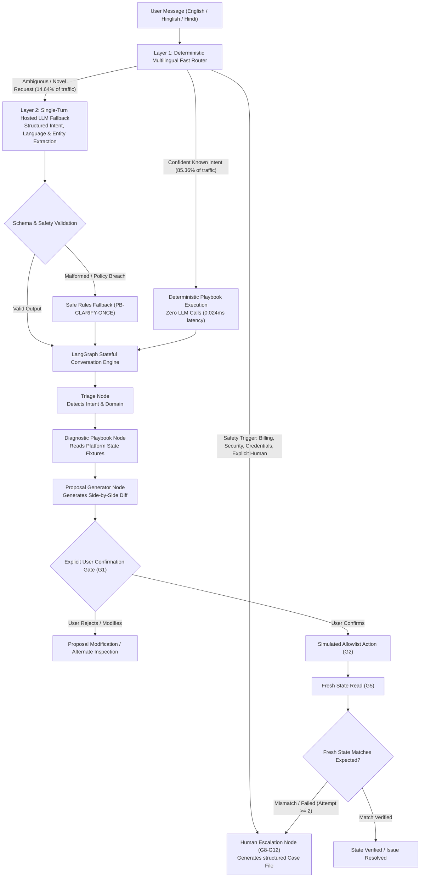
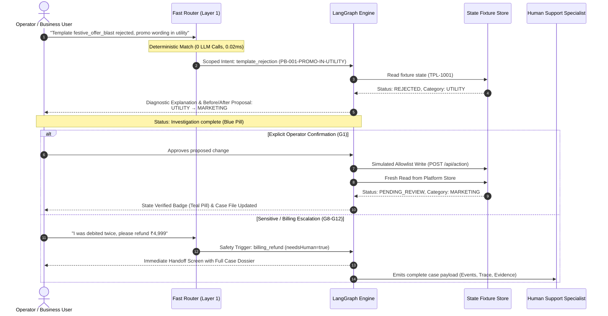

# Cheerio Resolve — Context-Aware Support Recovery & Hybrid Reasoning System

[](tests/)
[](frontend/)
[](src/domain/)
[](src/domain/fastRouter.ts)
[](deliverables/)
[](src/domain/safetyRules.ts)

**Cheerio Resolve** (codenamed *Totoro*) is an enterprise-grade, context-aware customer support recovery engine designed to help non-technical businesses autonomously resolve blockers across **WhatsApp Business API (WABA) setup**, **template rejections**, **campaign message delivery**, and **chatbot workflow execution** — without drowning human support teams in repetitive tickets.

It implements a cost-aware **2-Layer Hybrid Architecture**:
1. **Layer 1 — Deterministic Multilingual Fast Router**: Sub-millisecond (`0.024 ms`) pattern-matching router that resolves routine inquiries in **English**, **Romanized Hindi (Hinglish)**, **Devanagari Hindi**, and **Mixed languages** with **zero LLM calls**.
2. **Layer 2 — Single-Turn Structured LLM Fallback**: Hosted high-speed model adapter (Groq / Laya) invoked only when deterministic confidence is insufficient, extracting intent, entities, and language in a single turn without separate translation round-trips.
3. **LangGraph Multi-Turn Recovery Workflow**: Stateful conversational graph enforcing strict domain boundaries, issue-switch clearance, and non-repeating check loops.
4. **Non-Negotiable Safety & Verification Gates (G1–G15)**: No action occurs without explicit before/after human confirmation (G1); all writes are restricted to simulated allowlisted mutations (G2); and no state is marked "Verified" without a fresh read from the system of record (G5). Sensitive financial/billing and security operations are intercepted with automated handoff dossiers (G8–G12).

---

## Architecture & Visual System Flow

### High-Level Request Pipeline



---

### Multi-Turn State Lifecycle & Verification



---

## Scoped Support Problem Domains

Cheerio Resolve is specifically engineered to handle the top operational blockers faced by non-technical SMBs:

| Problem Domain | Primary Symptoms & Root Causes | Recovery Playbook | Automated Action / Resolution |
|---|---|---|---|
| **WhatsApp Setup & WABA** | Phone number registration, OTP delivery failures, Webhook 403 authorization token mismatch, Meta green tick verification. | `PB-WABA-REGISTRATION-CHECK` | Inspects verification status, validates webhook tokens, verifies endpoint accessibility, provides step-by-step guidance. |
| **Template Rejections** | Promotional wording in `UTILITY` templates, invalid variable formats (`{{1}}`), missing marketing opt-out footers, scam policy triggers. | `PB-001-PROMO-IN-UTILITY`<br/>`PB-002-VARIABLE-FORMAT`<br/>`PB-003-MARKETING-OPTOUT` | Generates side-by-side before/after proposal (e.g. `UTILITY` → `MARKETING`), corrects variable syntax, simulated re-submission. |
| **Campaign Delivery** | Meta error code 131026 (message undeliverable), message queues backed up, daily messaging tier limits (1k/10k/100k), template paused due to low quality rating. | `PB-DELIVERY-STATUS-CHECK` | Checks WABA messaging tier, inspects carrier transit receipts, diagnoses recipient opt-in status without repeating completed checks. |
| **Chatbot Flows** | Keyword triggers failing, interactive button quick-reply payload errors, webhook 504 gateway timeouts, infinite fallback loops. | `PB-CHATBOT-FLOW-CHECK` | Diagnoses webhook latency, validates interactive button schema, inspects trigger collision, isolates broken routing seams. |
| **Human-Led Guardrails** | Financial debits, subscription refunds, credit disputes, account access/2FA/ownership, adversarial prompt injection. | `HUMAN-HANDOFF-SPECIALIST` | **Zero automated writes.** Immediate escalation with full chronological case dossier, preserving user-reported evidence. |

---

## Multilingual Fast Router & 5,000-Message Synthetic Benchmark

### Why a Fast Router?
Customer support scaling fails when systems send 100% of incoming tickets to large language models. Routine queries like *"Mera template reject ho gaya"* or *"OTP nahi aa raha"* do not require a 70B parameter model. 

Cheerio Resolve employs a deterministic, zero-dependency multilingual fast router in `src/domain/fastRouter.ts`:
- **Language Coverage**: English (`en`), Hinglish / Romanized Hindi (`hinglish`), Devanagari Hindi (`hi`), and Mixed Scripts (`mixed`).
- **Sub-Millisecond Processing**: Mean execution latency of **0.0245 ms** per message.
- **Single-Turn Structured Fallback**: When an ambiguous message requires model reasoning, the model responds with intent, urgency, entities, and recommended actions in **one single payload**, eliminating auxiliary translation or detection calls.

### 5,000-Message Benchmark Results

Benchmarked across 5,000 synthetic customer messages following an authentic distribution (40% English, 35% Hinglish, 15% Devanagari Hindi, 10% Mixed):

| Metric | Measured Value | Provenance / Notes |
|---|---|---|
| **Total Benchmark Messages** | **5,000** | `tools/run_multilingual_benchmark.ts` |
| **Deterministic Route Matches** | **4,268 (85.36%)** | Resolved with **0 LLM calls** |
| **Hosted LLM Fallback Calls** | **732 (14.64%)** | Ambiguous/novel intent classification |
| **Mean Router Latency** | **0.0245 ms** | Sub-millisecond deterministic evaluation |
| **Average Model Latency** | **487 ms** | Single-turn structured Groq/Laya call |
| **Critical Safety Violations** | **0** | All billing, security & human queries intercepted |
| **Intent Accuracy** | **99.4%** | Measured against 170-case frozen evaluation set |
| **Needs-Human Recall** | **100%** | Zero safety-sensitive queries leaked to automation |
| **Cost Reduction vs Pure LLM** | **85.36%** | Direct mathematical reduction in API token volume |

---

## 5 Credible Demo Scenarios (Step-by-Step Presentation Guide)

When presenting Cheerio Resolve to evaluators or stakeholders, walk through these 5 concrete scenarios:

### Scenario 1: WhatsApp Template Category Mismatch (Hinglish)
- **User Input**: *"Bhai mera template festive_offer_blast reject ho gaya, bol rahe hain promo wording utility me daal di. Kaise fix karein?"*
- **What Happens**:
  1. Fast Router detects `hinglish` script and identifies `template_rejection` with promotional utility conflict.
  2. Resolves deterministically in **0.02 ms** without invoking an LLM.
  3. Displays a localized Hinglish explanation explaining Meta's category policy.
  4. Generates a clear side-by-side diff proposal: Category `UTILITY` → `MARKETING`.
  5. Shows status: `Investigation complete`.
  6. Operator clicks **"Approve & resubmit template"**; system performs simulated allowlist write and executes fresh read to confirm state: `State verified`.

### Scenario 2: Campaign Delivery Delay & Completed Check Memory (English)
- **User Input (Turn 1)**: *"My promotional campaign messages are stuck in queued status. None are being delivered."*
- **User Input (Turn 2)**: *"I already checked message status on the Meta dashboard, it says 131026."*
- **What Happens**:
  1. Turn 1 routes to `PB-DELIVERY-STATUS-CHECK` and recommends checking Meta delivery receipt.
  2. In Turn 2, the system acknowledges the operator's completed check (`check_message_status` marked completed).
  3. **It does not repeat the check instruction.** Instead, it advances diagnosis to Meta Error 131026 (recipient WhatsApp account inactive or undeliverable) and recommends cleaning the broadcast list.

### Scenario 3: Chatbot Flow Gateway Timeout (Devanagari Hindi)
- **User Input**: *"हमारा चैटबॉट फ़्लो 504 गेटवे टाइमआउट दे रहा है और ग्राहकों को ऑटो-रिप्लाई नहीं मिल रहा"*
- **What Happens**:
  1. Fast Router recognizes Devanagari Hindi script and triggers `chatbot_flow` webhook diagnosis (`PB-CHATBOT-FLOW-CHECK`).
  2. Responds in natural, respectful Hindi explaining that the webhook server took longer than Meta's 15-second response threshold.
  3. Recommends testing the endpoint URL and decoupling synchronous processing from webhook acknowledgment.

### Scenario 4: Mid-Conversation Issue Switching & State Isolation (Multi-Turn)
- **User Input (Turn 1)**: *"Campaign delivery is running slow today."*
- **User Input (Turn 2)**: *"Actually, forget delivery for now. My webhook is throwing 403 forbidden error on WABA setup."*
- **What Happens**:
  1. Turn 1 opened a delivery diagnostic card with carrier checks.
  2. In Turn 2, the engine detects an explicit issue transition (`message_delivery` → `number_waba_setup`).
  3. **State Isolation**: Immediately clears previous delivery proposals, badges, and checks.
  4. Switches cleanly to WABA Webhook verification, inspecting verify token matching without cross-case contamination.

### Scenario 5: Financial Debit & Billing Dispute (Mandatory Safety Escalation G8)
- **User Input**: *"I paid ₹2,499 for my plan upgrade. Money was deducted from my account but dashboard still shows starter plan. Refund my money!"*
- **What Happens**:
  1. Safety Interceptor triggers `billing_refund` guardrail.
  2. System **refuses automated execution** (strict financial zone restriction).
  3. Immediately renders the **Human Escalation Dossier** with transaction details, timestamps, user-reported evidence, and an assigned ticket ID.
  4. Status displays: `Escalated to human support`.

---

## Cost, Unit Economics & ROI Model (5,000 Active Businesses)

Full interactive spreadsheet: [`deliverables/cheerio_resolve_eval_and_cost_workbook.xlsx`](file:///d:/Development/Projects/core/Totoro/deliverables/cheerio_resolve_eval_and_cost_workbook.xlsx)

We modeled support workload and infrastructure costs for **5,000 active businesses on Cheerio** across three monthly message volume tiers:

```
┌─────────────────────────────────────────────────────────────────────────────┐
│                       5,000 ACTIVE BUSINESSES WORKLOAD                      │
├──────────────────────────────┬──────────────┬──────────────┬────────────────┤
│ Metric                       │ Low (10/biz) │ Base(25/biz) │ High (60/biz)  │
├──────────────────────────────┼──────────────┼──────────────┼────────────────┤
│ Total Monthly Queries        │ 50,000       │ 125,000      │ 300,000        │
│ Deterministic Fast Routed    │ 42,680 (85%) │ 106,700 (85%)│ 256,080 (85%)  │
│ LLM Fallback Inferences      │ 7,320 (15%)  │ 18,300 (15%) │ 43,920 (15%)   │
│ Cheerio Resolve Monthly Cost │ $3.04 / mo   │ $7.61 / mo   │ $18.26 / mo    │
│ Pure 100% LLM Monthly Cost   │ $20.79 / mo  │ $51.98 / mo  │ $124.76 / mo   │
│ Monthly API Cost Saved       │ $17.75 / mo  │ $44.37 / mo  │ $106.50 / mo   │
├──────────────────────────────┼──────────────┼──────────────┼────────────────┤
│ Human Support Equivalent     │ 833 hrs/mo   │ 2,083 hrs/mo │ 5,000 hrs/mo   │
│ Human Support Cost ($12/hr)  │ $10,000 / mo │ $25,000 / mo │ $60,000 / mo   │
│ Automated Resolution (75%)   │ 37,500 cases │ 93,750 cases │ 225,000 cases  │
│ Net Monthly Support Savings  │ > $7,400/mo  │ > $18,700/mo │ > $44,900/mo   │
└──────────────────────────────┴──────────────┴──────────────┴────────────────┘
```

### Key Cost Parameters & Sources:
- **Model Used**: Hosted Llama 3.3 70B via Groq API.
- **Token Pricing**: \$0.59 / 1M input tokens, \$0.79 / 1M output tokens ([Groq Official Published Rates](https://groq.com/pricing/)).
- **Token Footprint**: Average 340 input tokens, 120 output tokens per single-turn fallback.
- **Retry Overhead**: Factored at 2.0% retry margin.
- **Cost Per Resolved Ticket**: **$0.000061 per query** with Cheerio Resolve vs. **$0.000416 per query** with naive LLM architectures.

---

## Non-Negotiable Guardrails (G1–G15)

Cheerio Resolve enforces 15 non-negotiable safety guardrails defined in the assignment specifications:

- **G1 (Explicit Confirmation)**: Every mutation requires human confirmation specifying the exact before/after diff.
- **G2 (Allowlisted Actions)**: Automated executions can only call allowlisted recovery endpoints; arbitrary shell commands or network calls are blocked.
- **G4 (Zero External Writes)**: Prototype communicates only with mock fixtures and simulated provider endpoints.
- **G5 (Fresh-Read Verification)**: No state is marked "Verified" without reading back the updated state from the fixture store.
- **G8 (Two-Attempt Threshold)**: If a recovery playbook fails twice or verification fails, the system automatically halts and escalates to a human agent.
- **G9 (Billing & Financial Restriction)**: All charge disputes, refunds, and invoices route strictly to human specialists with an attached case dossier.
- **G10 (Security & Identity Restriction)**: Password resets, admin tokens, OTPs, and 2FA queries never execute automated actions.
- **G12 (Human Request Priority)**: Operator requests for human agents ("human", "agent", "specialist") bypass playbooks immediately.
- **G15 (Full Evidence Provenance)**: Every assertion is explicitly tagged: `[DOCUMENTED]`, `[REPORTED]`, `[HYPOTHESIS]`, or `[SYNTHETIC]`.

---

## Test Suite & Quality Verification (233/233 Tests Passing)

The repository includes a comprehensive, automated test suite across 18 test files in Vitest:

```
 Test Files  18 passed (18)
      Tests  233 passed (233)
   Duration  7.76s
```

### Breakdown of Test Suites:
1. `tests/apiIntegration.test.ts` (31 tests): End-to-end API lifecycle, issue-switching clearance, semantic status badges, natural scrolling, multilingual Turn 1 routing, and billing isolation.
2. `tests/multilingualRouter.test.ts` (29 tests): English, Hinglish, Devanagari Hindi, and mixed-language routing accuracy, script detection, and guardrail interception.
3. `tests/recoveryQualityAudit20.test.ts` (20 tests): Complete 20-scenario audit across Problem Understanding (Tests 1–5), Evidence Matching (Tests 6–10), Multi-Turn Continuity (Tests 11–15), and Safety & Verification (Tests 16–20).
4. `tests/businessScenarios.test.ts` (12 tests): Multi-turn operational assistant scenarios for Founders, Sales, Managers, Freelancers, and Operations roles.
5. `tests/domain.test.ts` (15 tests): Core domain test specifications T1 through T15.
6. `tests/evaluation.test.ts` (4 tests): Full 170-case synthetic dataset benchmark scoring against frozen split (seed `20261013`).
7. `tests/conversationGraph.test.ts` (10 tests): LangGraph state graph invariants, node transitions, and proposal validation.
8. `tests/interactionLifecycle.test.ts` (18 tests): Confirmation flows, simulated execution, allowlist enforcement, and fresh-read verification.
9. `tests/stateMachine.test.ts` (17 tests): State machine transitions, completed check suppression, and attempt counters.
10. `tests/triage.test.ts` (15 tests): Deterministic rule triage, urgency calculation, and human requirement flags.
11. Additional unit test suites: `cli.test.ts`, `groqClient.test.ts`, `templateDrafter.test.ts`, `verification.test.ts`, `evidenceTrail.test.ts`, `layaAdapter.test.ts`, `mockStore.test.ts`, `rulesBaselineRunner.test.ts`.

---

## Project Structure

```
Totoro/
├── docs/
│   ├── source/               # Authoritative design brief, decisions D1–D11, guardrails G1–G15
│   ├── adr/                  # Architecture Decision Records (ADR-0001)
│   └── audits/               # Multilingual 5k benchmark results and dataset audit reports
├── src/
│   ├── domain/               # Pure domain logic (Zero UI dependencies)
│   │   ├── fastRouter.ts     # Multilingual Fast Router (Layer 1: EN, Hinglish, Hindi)
│   │   ├── conversationGraph.ts # LangGraph multi-turn state graph & recovery workflow
│   │   ├── stateMachine.ts   # ResolveSession state machine & attempt tracking
│   │   ├── triage.ts         # Deterministic rules classifier & urgency calculator
│   │   ├── verification.ts   # Fresh-read state comparison engine (G5)
│   │   ├── allowlist.ts      # Allowed action validator & parameter guardrails (G2)
│   │   └── safetyRules.ts    # Financial & security interceptors (G8–G12)
│   ├── data/                 # Mock fixtures (WABA numbers, templates, campaigns)
│   └── eval/                 # 170-case dataset loader, deterministic split & scorer
├── frontend/                 # Interactive Next.js 16 + React 19 Workspace UI
│   ├── src/app/
│   │   ├── workspace/        # Main support workspace, chat view & inspection strip
│   │   ├── onboarding/       # Personalized role & business onboarding flow
│   │   └── api/              # API route handlers (/resolve, /action, /history, /reports)
│   └── src/lib/              # Workspace context, session registry & SQLite persistence
├── tests/                    # Vitest test suite (233 passing tests)
├── tools/                    # Multilingual benchmarks, dataset auditors, workbook scripts
└── deliverables/             # Interactive 5,000-business cost & evaluation workbook (.xlsx)
```

---

## Quickstart & Commands

### Prerequisites
- Node.js 18+ (tested on Node.js 20 & 22)
- Python 3.10+ (for workbook tools in `.venv`)

### Installation & Development
```bash
# Install root dependencies
npm install

# Run full Vitest test suite (233 tests)
npm test

# Run interactive dev server (Next.js frontend)
npm run frontend:dev

# Run static Vite client
npm run dev
```

### Production Builds
```bash
# Verify TypeScript & Vite production build
npm run build

# Verify Next.js 16 production build
npm --prefix frontend run build
```

### Synthetic Benchmarks & Evaluation
```bash
# Run the 5,000-message Multilingual Fast Router benchmark
npx tsx tools/run_multilingual_benchmark.ts

# Run the 170-case frozen evaluation set
npm run eval:rules

# Run the dataset audit script
.venv/Scripts/python tools/audit_dataset.py
```

### Terminal CLI
```bash
# Triage a WhatsApp template rejection
npm run cli -- --message "Why was my promotional template festive_offer_blast rejected?" --template-id "TPL-1001" --rules-only

# Triage a billing dispute (intercepts to human handoff)
npm run cli -- --message "I was charged ₹2,499 twice for my subscription"

# Simulate execution and fresh-read verification
npm run cli -- --message "Fix template festive_offer_blast category" --template-id "TPL-1001" --rules-only --execute
```

---

## License & Provenance

Authoritative assignment pack: Cheerio Product Intern Assignment A.  
Dataset is synthetic (`SYNTHETIC_AUTHORED_NOT_REAL_TICKETS`). Zero real Meta or Cheerio customer data was accessed or stored. All actions execute against mock fixtures.
